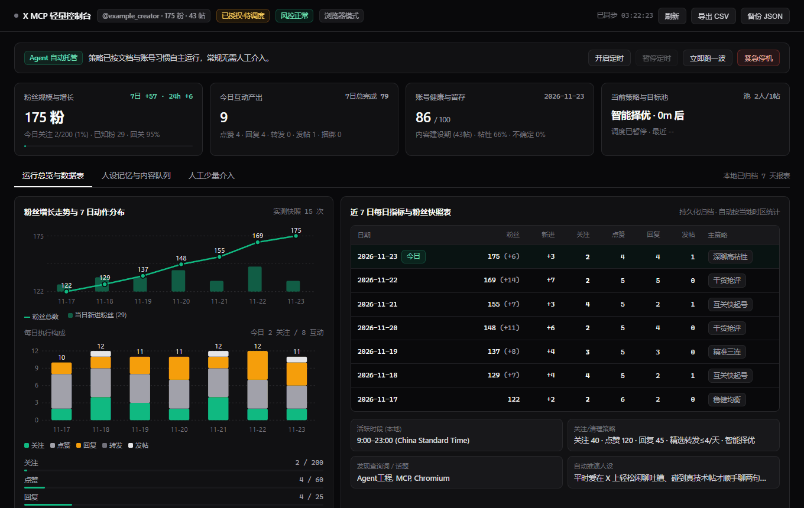
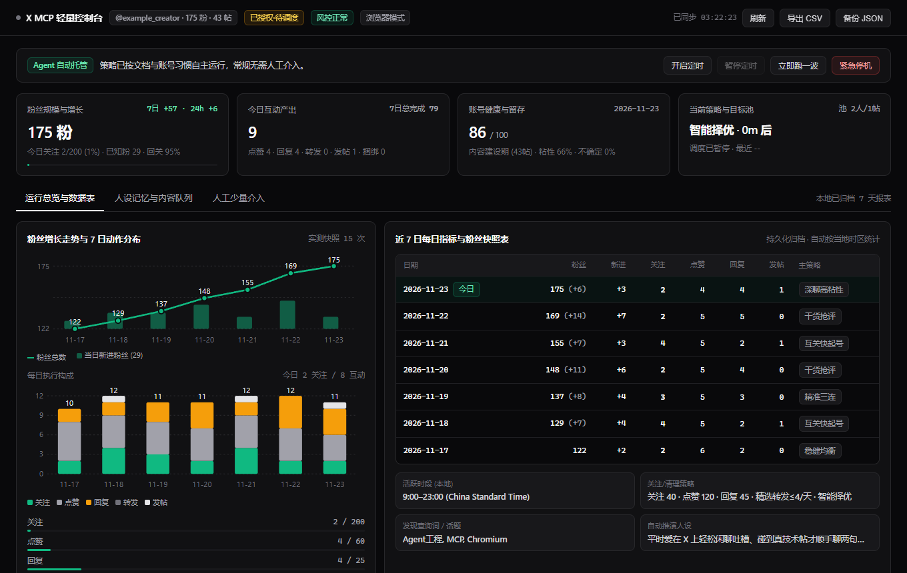
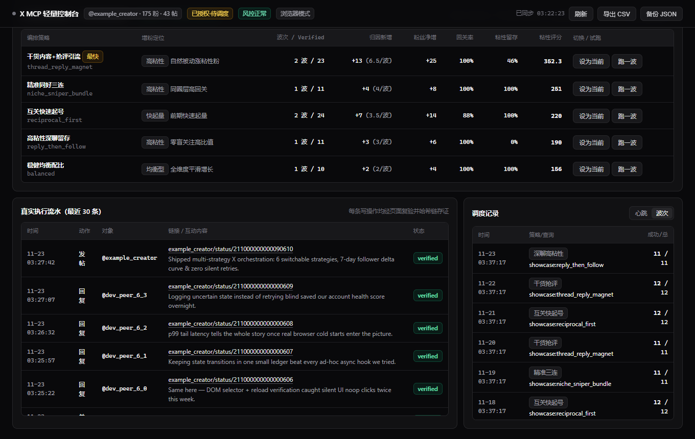
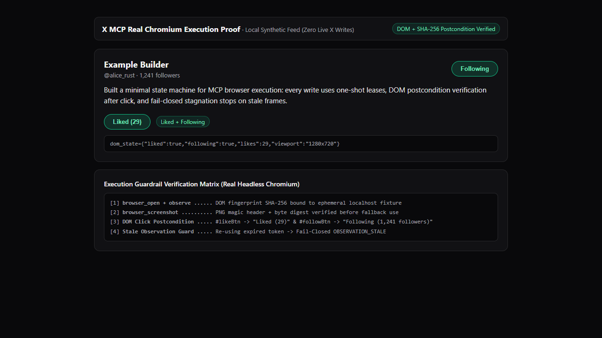
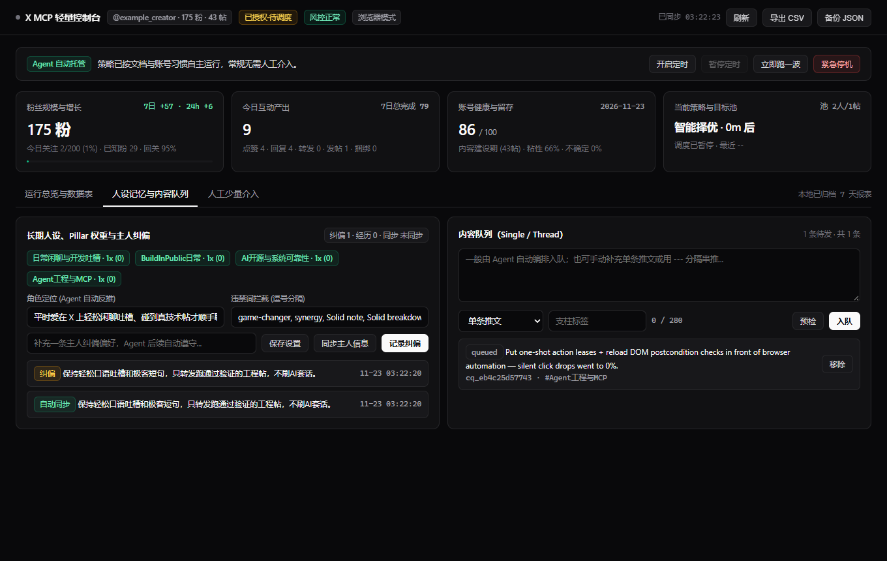

# X MCP — Verifiable AI Operator for X (Browser + OAuth MCP Server)

Language: English · [简体中文](README.zh-CN.md)

**Give any MCP-capable AI Agent (Codex, Claude Desktop, OpenClaw) a dedicated Chrome browser and strict safety guardrails to read X, write natural multi-language replies, compare 6 growth strategies, and verify every action on-page — with $0 X API fees.**

<p align="center">
  
  <br />
  <sub>Real Chromium + local Streamable HTTP server rendering sanitized showcase data (<code>@example_creator</code>) — 7-day follower delta, 6-strategy leaderboard, persona queue, and DOM verification proof.</sub>
</p>

---

## Why X MCP? (What Problem It Solves in 10 Seconds)

| Challenge with X Automation | Typical Fragile Scripts / Raw API | How **X MCP** Solves It |
|---|---|---|
| **X API Paywall** | Requires paid Developer tier just to interact | **$0 API cost** in signed-in Chrome mode + credential-free public web reads (optional OAuth API mode supported) |
| **Account Suspension** | Machine-speed bursts, blind retries, no cooldowns | Randomized human gaps (`32–165s`), fail-closed **circuit breaker** on HTTP `429` / refusal codes (`283`/`161`/`141`/`37`), **zero silent retry on `uncertain`** |
| **Noisy "Clicking Nothing"** | Fires click and assumes success | **One-shot action lease** -> Chromium click -> **reload postcondition verification** -> **SHA-256 hash-chained evidence ledger** |
| **Robotic AI Replies** | "Solid breakdown! Deep insights!" spam | Card chrome stripping + fail-closed skip on vague short posts + multi-lang (`EN/ZH/JA/KO`) anti-AI tone & anti-cliché blocklist |
| **Guessing What Grows Followers** | Fixed script with no attribution | **6 switchable strategies**, 7-day `followers_count` trend & mutual attribution, auto-adapting **`auto_fastest`** |

---

## Real-Device Visual Showcase

Every screenshot below was captured directly from real headless Chromium running against our local web console (`ui/dashboard.html`) and synthetic verification page (`@example_creator`, zero private accounts or secrets):

<table>
  <tr>
    <td width="50%" valign="top">
      <strong>1. Obsidian-Zinc Console &amp; 7-Day Follower Curve</strong><br />
      
      <br /><sub>Live KPI cards, 7-day follower count line + inbound bars, daily stacked action bars, quota gauges, and active strategy policy.</sub>
    </td>
    <td width="50%" valign="top">
      <strong>2. Multi-Strategy Race Leaderboard &amp; Verified Audit Log</strong><br />
      
      <br /><sub>Compares 6 strategies on sticky follower delta &amp; conversion alongside the hash-chained execution stream and wave log.</sub>
    </td>
  </tr>
  <tr>
    <td width="50%" valign="top">
      <strong>3. Real Chromium DOM Postcondition &amp; Guardrail Proof</strong><br />
      
      <br /><sub>Proves PNG SHA-256 verification, DOM state change (<code>Like -&gt; Liked</code>, <code>Follow -&gt; Following</code>), and fail-closed <code>OBSERVATION_STALE</code> rejection.</sub>
    </td>
    <td width="50%" valign="top">
      <strong>4. Persona Memory, Anti-AI Guard &amp; Content Queue</strong><br />
      
      <br /><sub>Owner role preset (<code>tech_casual</code>), banned AI phrase filters, feedback correction log, and single/thread content queue.</sub>
    </td>
  </tr>
</table>

---

## Measured Capabilities & Verification Data (`v0.10.0`)

We strictly separate local benchmarks, real-Chromium fixtures, multi-strategy simulations, and real live-X verification runs so you see real limits alongside capabilities:

| Evidence Level | Check / Scenario | Measured Result (`2026-11-23`) | Exact Scope & Repro Command |
|---|---|---|---|
| **Live-X Real Agent Run** *(Historical)* | External Agent 20-run follow campaign (`2026-11-03~05`) | **`202` unique verified follows** · `0` duplicates · `202/202` mutual proof · `4.0 s` median write | Real X account; `100` `uncertain` rows & `3` real HTTP `429` halted fail-closed ([report](docs/reports/AGENT-FOLLOW-200-2026-11-05.md)) |
| **Live-X Owner Acceptance** *(Historical)* | Bounded interactive write window | **`31` verified actions in `133 s`** (`20` likes, `1` repost, `10` replies) | Single owner-controlled acceptance batch ([changelog](CHANGELOG.md)) |
| **Real Chromium E2E** *(Local Live)* | `showcase.py` Chromium guardrail run | **`1,619 ms`** full flow · PNG SHA-256 valid · Like/Follow DOM verified · `OBSERVATION_STALE` rejected | Real headless Chrome on local synthetic X feed (`python -X utf8 scripts/showcase.py`) |
| **Real Chromium Matrix** *(Local Live)* | `executor_visual_e2e.py` + `executor_matrix_e2e.py` | **`9/9`** visual fallback + **`42/42`** viewport/DPR/locale/theme checks (`0` failures) | Real Chrome across 6 viewports (`1280x720@1`, `1920x1080@1.5`, `390x844@3`, `820x1180@2`, etc.) |
| **7-Day Growth & Audit Sim** *(Local)* | Multi-strategy attribution (`showcase.py`) | **`118 -> 175` followers (`+57`, `+48.3%`)** · `79` verified actions · **`173` valid SHA-256 chain entries** | Local browser-mode simulation across 5 strategies (`thread_reply_magnet` won `352.3`) |
| **200-Target Ledger Concurrency** | `e2e/follow_pressure.py --targets 200` | **`200/200` completed in `12.471 s`** (`16.04 actions/s`, `402` evidence records, `valid: true`) | Confirmation gate + one-shot lease + SHA-256 ledger only (no browser/X) |
| **Streamable HTTP Load Test** | `scripts/loadtest.py --clients 512 --requests 10` | **`516.36 RPS`** across `5,120` requests · **`0` errors (`0.0%`)** · `tools/call` p50 `24.13 ms` | Local Streamable HTTP mock (`65` tools catalog, no X calls) |
| **Protocol Core Microbenchmark** | `scripts/benchmark.py --iterations 5000` | **`181,850 ops/s`** (`tools/list` p50 `0.004 ms`) · **`105,707 ops/s`** (`x_timeline_observe`) | In-process Python MCP core (`network_calls=0`) |
| **Public Web Read** *(Live-X Cold)* | `x_public_profile` | **`1.31–1.59 s`** cold profile fetch | Credential-free public read; rapid bursts observe X `HTTP 429` |
| **Automated Test Suite** | `unittest discover` + `release_check` + `smoke` | **`701/701` unit tests `OK`** · `release_check: PASS` · `65/65` tools stdio smoke | Offline + synthetic suite run on every release commit |

---

## Try the 10-Second Live Showcase Yourself

No X account or API key needed to verify core MCP discovery, real Chromium DOM execution, and multi-strategy attribution on your own machine:

```powershell
python -X utf8 scripts/showcase.py
# Or on Windows via the portable wrapper:
tester.cmd showcase
```

For full machine-readable telemetry (`--json`) or regenerating clean screenshots & GIF (`--capture-assets`):

```powershell
python -X utf8 scripts/showcase.py --json
```

---

## How It Works (3 Steps: Agent Prepares, Owner Approves)

```text
  [1. MCP Agent (Codex / Claude / OpenClaw)]
     |-- Calls x_persona_memory, x_search_posts, x_target_pool, x_autopilot(prepare)
     '-- Selects best growth strategy & prepares 7-day plan + expiring confirmation phrase
               |
               v  (Owner reviews once at http://127.0.0.1:8765/)
  [2. Human Owner Review Console (ui/dashboard.html)]
     |-- Clicks "Approve Agent Plan" (or switches strategy / hits Emergency Stop anytime)
               |
               v
  [3. Browser Executor + Hash-Chained Ledger]
     |-- Drives dedicated Chrome profile (zero cookie/password export)
     |-- Verifies DOM / visual coordinate guard -> reloads to prove state changed
     '-- Appends SHA-256 entry to x_evidence_get -> snapshots followers -> adapts auto_fastest
```

[`skill.md`](skill.md) enforces the contract: **your Agent configures and executes within budget; you only review and approve.**

---

## Quick Start (Windows / Chrome Signed-In Mode)

Requirements: **Python 3.11+** (recommended `3.12`), **Google Chrome** for the signed-in browser path, and optionally **Node.js 20+** / **Pillow** for conformance checks or GIF generation.

### 1. Launch Browser Mode + Web Console

```powershell
dashboard.cmd
```

Starts Streamable HTTP MCP (`http://127.0.0.1:8765/mcp`) in browser mode with a dedicated isolated Chrome profile (`.browser-main-profile`) and opens `http://127.0.0.1:8765/`.

Manual source launch + first-time human sign-in:

```powershell
$env:X_STARTER_OWNER_PROFILE = "$env:LOCALAPPDATA\x-starter\owner-profiles\owner-x"
python -I -X utf8 scripts/owner_login_open.py
python -I -X utf8 scripts/owner_login_check.py

$env:X_STARTER_MODE = "browser"
$env:X_STARTER_ENABLE_BROWSER = "1"
python -I -X utf8 server.py --transport http --port 8765
```

### 2. Connect Codex / Claude Desktop / OpenClaw

```powershell
tester.cmd setup
tester.cmd smoke
tester.cmd doctor
tester.cmd config
```

Copy one generated block from `mcp-client.json` or `mcp-codex.toml` into your MCP client config, then give [`skill.md`](skill.md) + [`docs/ONE-CLICK-PROMPT.md`](docs/ONE-CLICK-PROMPT.md) to your Agent.

<details>
<summary>First read-only Agent test prompt (0 writes)</summary>

```text
Use xstarter MCP. First call tools/list.
Call x_public_profile for screen_name="NASA" and x_public_timeline with limit=3.
Report tool names, URLs, result counts, elapsed time, and error codes.
Do not log in or perform any writes.
```

</details>

---

## Architecture & Tool Groups (65 Unique Tools)

1. **Public Read Path** (`x_public_profile`, `x_public_timeline`, `x_public_post`): Reads public X profiles, timelines, and posts with zero credentials.
2. **Signed-In Browser Path** (`browser_*`, `x_owner_read`, `x_visit_profile`, `x_follow_batch_*`, `x_interaction_batch_*`): Drives a persistent Chrome profile using DOM/a11y locators first and SHA-256 coordinate fallback second.
3. **OAuth / X API Path** (`x_oauth_*`, `x_post_prepare_api`, `x_post_create_api`): Optional host-managed OAuth 2.0 PKCE + X API writes.
4. **Autonomous Growth Orchestration & Safety (`x_autopilot`, `x_account_health`, `x_persona_memory`)**:
   - **6 Switchable Strategies**: `auto_fastest` (adaptive leaderboard winner with 20% exploration), `reciprocal_first`, `niche_sniper_bundle`, `thread_reply_magnet`, `reply_then_follow`, `balanced`.
   - **Standing & Guardrails**: Warmup stages (`ghost -> light_engage -> content_build -> growth`) with active early-stage drop-by (`visit -> 1-2 warm likes -> 1 caring casual reply` prioritizing quiet peer threads), `analyze_post` empathy analysis + [`docs/INTERACTION-PLAYBOOK.md`](docs/INTERACTION-PLAYBOOK.md) anti-AI casual templates, curated repost quality gate (`score_technical_quality`, `<= 4/day`), `tech_casual` persona preset, `clean_post_body` noise stripping, `2h` challenge cooldown, and strict `Origin` + `X-Frame-Options: DENY` local HTTP hardening. See [`docs/orchestration-profile-safe.json`](docs/orchestration-profile-safe.json) and our [`2026-11-14` suspension postmortem](docs/reports/POSTMORTEM-SUSPENSION-2026-11-14.md).

<details>
<summary>Full 65-tool capability map & repository tree</summary>

| Group | Key Tools | Purpose |
|---|---|---|
| Public Read | `x_public_profile`, `x_public_timeline`, `x_public_post` | Credential-free profile, timeline & post inspection |
| Owner & Discovery | `x_owner_read`, `x_account_get`, `x_timeline_observe`, `x_search_posts`, `x_visit_profile`, `x_notifications_read` | Signed-in reads, niche/cross-language search, profile visit before engaging, mention monitoring |
| Health & Persona | `x_account_health`, `x_persona_memory`, `x_target_pool`, `x_content_queue` | Warmup stages, `tech_casual` preset, throttled `sync_owner`, scout target pool, single/thread queue |
| Autopilot & Strategy | `x_daily_orchestrate_plan`, `x_daily_orchestrate_prepare`, `x_daily_orchestrate_execute`, `x_autopilot` | Weighted waves, 7-day bounded autopilot, `set_strategy`, follower trend & CSV/JSON export |
| Verified Writes | `x_post_prepare`, `x_post_publish`, `x_post_delete`, `x_interaction_batch_*`, `x_follow_candidates_read`, `x_follow_batch_*` | Server confirmation phrases, chunked leases, reload verification |
| Browser & Ledger | `browser_*`, `x_browser_next_action`, `x_browser_complete_action`, `x_browser_action_get`, `x_evidence_get` | Chromium DOM + guarded visual fallback, external Computer-Use contract, SHA-256 chain |
| OAuth & Gateway | `x_oauth_*`, `x_post_*_api`, `connector_*`, `x_compose_workbench`, `agent_help_request_*`, `ahan_handoff` | Host OAuth PKCE, capability negotiation, MCP Apps composer, AHAN boundary |

```text
x-starter/
├── server.py                     MCP server entrypoint (stdio + Streamable HTTP) & web console host
├── dashboard.cmd / tester.cmd    Windows one-click dashboard & test/showcase launcher
├── skill.md / public_skill.md    Agent operating contract & public connector skill
├── connector-manifest.json       Connector capabilities & schema manifest
├── src/                          Runtime core (orchestrator, autopilot, budgets, bridge, Chromium executor, OAuth)
├── ui/                           Obsidian-Zinc web console (dashboard.html) & MCP Apps composer (composer.html)
├── scripts/                      showcase.py, benchmark.py, loadtest.py, release_check.py, selfcheck.py, tester.py
├── e2e/                          Chromium visual/matrix checks, follow pressure & loopback E2E suites
├── tools/                        CLI utilities (safe pacing, window/calibration permits, lease cleanup, audits)
├── examples/                     Codex, Claude Desktop, OpenClaw & raw HTTP client examples
├── tests/                        Unit & offline contract suite (701+ tests)
└── docs/                         Visual assets, prompts, release boundaries, benchmark & postmortem reports
```

</details>

---

## Verification, Contributing & License

```powershell
python -I -X utf8 scripts/selfcheck.py
python -I -X utf8 scripts/release_check.py
python -m unittest discover -s tests -p "test_*.py"
```

- Contribution rules & security reporting: [`CONTRIBUTING.md`](CONTRIBUTING.md), [`CODE_OF_CONDUCT.md`](CODE_OF_CONDUCT.md), [`SECURITY.md`](SECURITY.md).
- Release boundaries & performance details: [`docs/RELEASE_READINESS.md`](docs/RELEASE_READINESS.md), [`docs/PERFORMANCE.md`](docs/PERFORMANCE.md).
- License status: No open-source `LICENSE` has been committed yet; see [`docs/LICENSE-DECISION.md`](docs/LICENSE-DECISION.md) before redistributing.
- Repository: <https://github.com/Guoz7/x-mcp>
