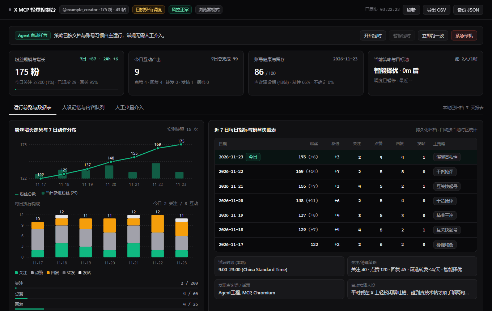
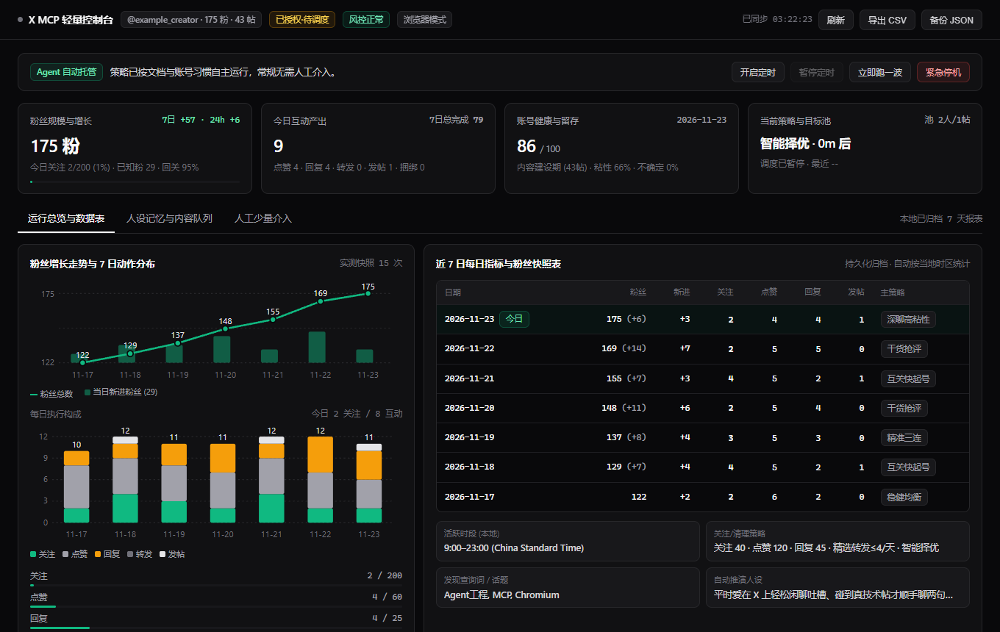
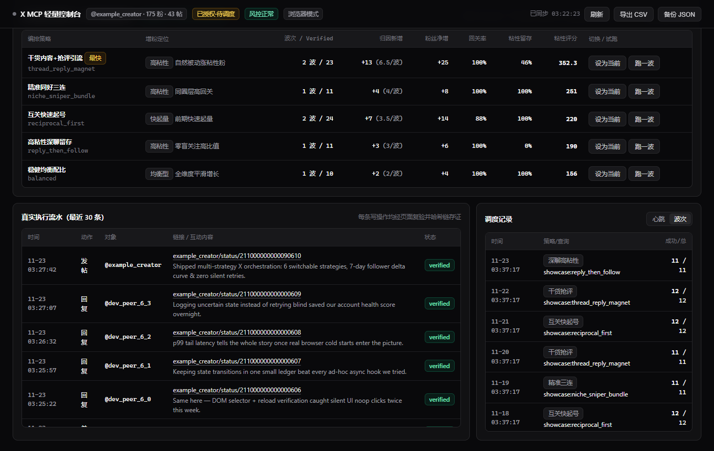
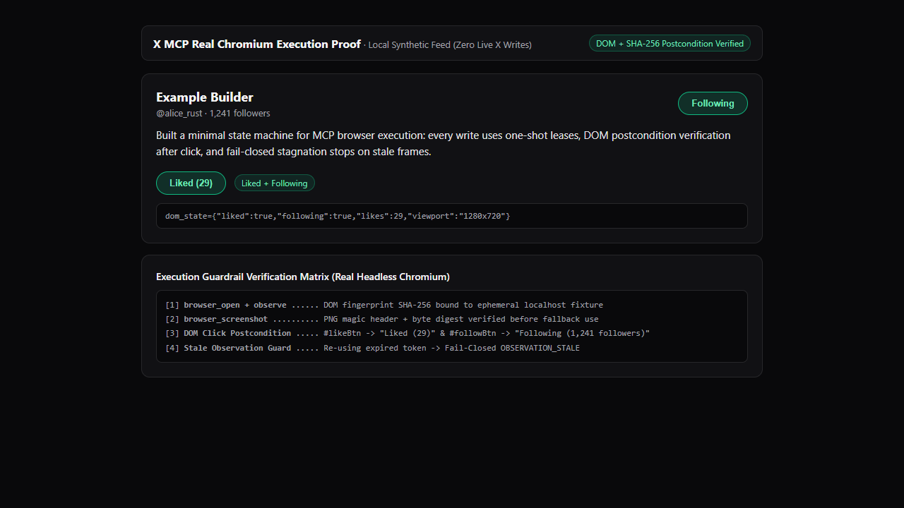
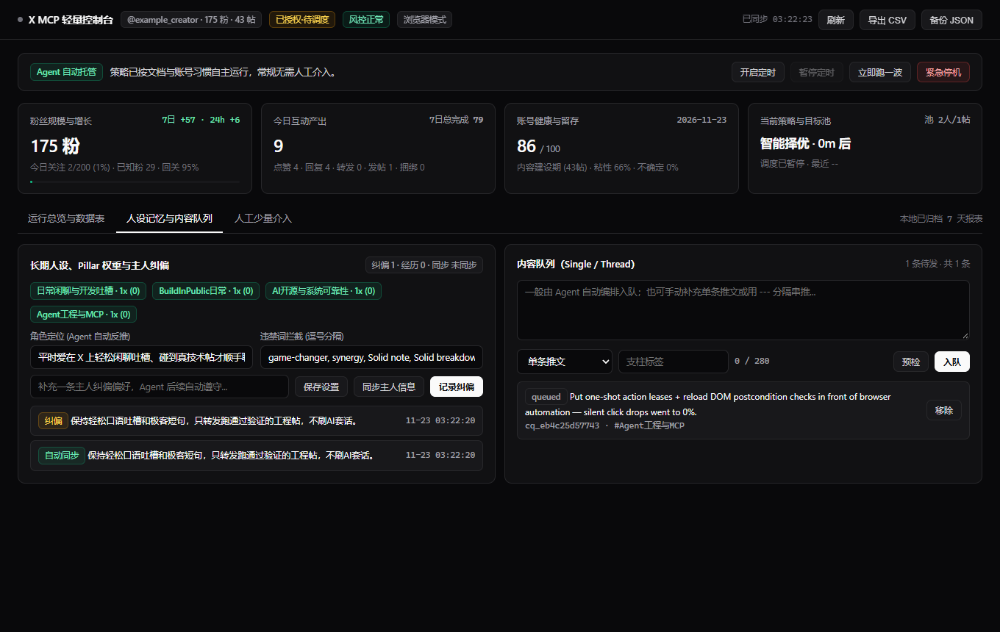

# X MCP — 可验证、带风控守护的 AI 自动化运营引擎

语言：[English](README.md) · **简体中文**

**把 Codex / Claude Desktop / OpenClaw 等任意支持 MCP 的 AI Agent，变成一台「专享浏览器驱动 + 页面刷新复验 + 安全风控隔离」的 X 运营搭档——0 X API 费用，常规流程全部由 Agent 自动配置执行，人类只需在控制台点一次同意。**

<p align="center">
  
  <br />
  <sub>基于真实无头 Chromium + 本地 Streamable HTTP 控制台录制（使用脱敏演示账号 <code>@example_creator</code>）：展示 7 日涨粉曲线、6 套策略赛马对比、人设/内容队列与页面 DOM 复验。</sub>
</p>

---

## 一眼看懂：它解决什么真实痛点？

| 传统脚本 / 官方 API 痛点 | 常见问题 | **X MCP 的解法** |
|---|---|---|
| **官方 X API 太贵** | 仅互动读写就要付费 Developer 套餐 | 登录态走专属 Chrome Profile（**0 X API 费用**），公开读取免登录免 Key，同时可选托管 OAuth API |
| **容易高频刷爆被封号** | 固定间隔连点、报错还硬重试 | 内置随机人类节奏（`32–165s`）、遇 `429` 或风控码（`283`/`161`/`141`/`37`）立刻熔断冷却，**`uncertain` 绝不盲目重试** |
| **点了没生效还以为成功** | 脚本发出点击即计数，漏转/漏粉 | **单次动作租约 -> 浏览器执行 -> 页面刷新复验（`Following`/`liked`）-> SHA-256 哈希链证据账本** |
| **评论一看就是 AI 味** | 英文套话 / 强扯系统架构 / 回复“咋了” | 剥离帖子页头页尾噪音、超短/无上下文原帖静默跳过，内置中/英/日/韩口语化反 AI 词库 |
| **不知道哪种打法涨粉最快** | 一套死板策略用到头，留存未知 | **6 套可切换编排策略** + 7 日粉丝净增走势图 + 互关粘性留存榜，自动将 `auto_fastest` 切到实测冠军 |

---

## 实机画面截图（全部由真实 Chromium 渲染截取）

下方 4 张截图均来自真实 `server.py` Web 控制台（`ui/dashboard.html`）与真实无头 Chrome 执行页面（全程使用脱敏合成账号 `@example_creator`，不含任何私人数据）：

<table>
  <tr>
    <td width="50%" valign="top">
      <strong>1. Obsidian-Zinc 控制台与 7 日涨粉曲线</strong><br />
      
      <br /><sub>顶部核心 KPI（粉丝规模、7 日净增、健康分、当前策略）、SVG 粉丝曲线与每日堆叠执行柱状图、分动作安全配额进度条。</sub>
    </td>
    <td width="50%" valign="top">
      <strong>2. 多套策略赛马排行榜 &amp; 哈希链审计流水</strong><br />
      
      <br /><sub>直观对比 6 套策略的波次、归因新增、粉丝净增、回关率与粘性评分（支持一键热切换），下方附带逐条页面复验流水与波次记录。</sub>
    </td>
  </tr>
  <tr>
    <td width="50%" valign="top">
      <strong>3. 真实 Chromium DOM 后置复验与防陈旧守卫</strong><br />
      
      <br /><sub>真实无头 Chrome 对本地 X 样式页面执行点赞（<code>Liked (29)</code>）与关注（<code>Following</code>），校验截图 PNG SHA-256 并拦截陈旧观测令牌（<code>OBSERVATION_STALE</code>）。</sub>
    </td>
    <td width="50%" valign="top">
      <strong>4. 长期人设记忆、违禁词拦截与内容队列</strong><br />
      
      <br /><sub>管理 <code>tech_casual</code> 人设支柱、AI 违禁套话词库、主人实时纠偏日志，以及单条/串推（Thread）待发队列。</sub>
    </td>
  </tr>
</table>

---

## 实测数据与边界（每一项均标注来源与口径）

我们严格区分 **真实 X 历史运行**、**本机真实 Chromium 实机验收** 与 **本地离线压力/策略模拟**，不做虚假夸大：

| 证据层级 | 测试项目 | 实测结果（`2026-11-23` 复验 / 历史归档） | 口径边界与复现方式 |
|---|---|---|---|
| **真实 X + 真实 Agent** *(历史)* | 20 轮 External Agent 关注验收（`2026-11-03~05`） | **`202` 个唯一已验证关注** · `0` 重复 · `202/202` 双向核验 · 中位耗时 `4.0 s` | 真实 X 账号；其余 `100` 条 `uncertain` 与 `3` 次真实 `429` 按规中止不重试（[报告](docs/reports/AGENT-FOLLOW-200-2026-11-05.md)） |
| **真实 X + 主人受控波次** *(历史)* | 混合互动批处理验收 | **`31` 个已验证动作 / `133 秒`**（`20` 赞、`1` 转、`10` 评） | 单账号受控波次实测（[更新日志](CHANGELOG.md)） |
| **真实 Chromium 实机演示** | `scripts/showcase.py` 浏览器执行段 | **`1,619 ms`** 全流程 · 截图 SHA-256 校验通过 · 点赞/关注 DOM 生效 · 拦截 `OBSERVATION_STALE` | 真实无头 Chrome 访问本地合成 X 演示页（`python -X utf8 scripts/showcase.py`） |
| **真实 Chromium 兼容矩阵** | `executor_visual_e2e.py` + `executor_matrix_e2e.py` | **`9/9`** 视觉兜底 + **`42/42`** 视口/DPI/语言/深浅色矩阵全过（`0` 失败） | 覆盖桌面（`1280x720`/`1920x1080`）、平板（`820x1180@2`）、手机（`390x844@3`） |
| **7 日多策略涨粉 & 审计模拟** | `showcase.py` 编排与哈希链演示 | 粉丝 **`118 -> 175`（7日 `+57` / `+48.3%`）** · `79` 笔验证写操作 · **`173` 条哈希链有效** | 本地浏览器模式多策略对比（自动识别 `thread_reply_magnet` 为最快粘性策略 `352.3`） |
| **200 目标高并发台账压测** | `e2e/follow_pressure.py --targets 200` | **`200/200` 在 `12.471 秒`内完成**（`16.04 actions/s`，`402` 条证据链 `valid: true`） | 仅验证确认门禁、单次租约与 SHA-256 台账落盘，不连 X |
| **Streamable HTTP 并发压测** | `scripts/loadtest.py --clients 512 --requests 10` | **`516.36 RPS`**（`5,120` 次请求）· **`0` 错（`0.0%`）** · `tools/call` p50 `24.13 ms` | 本地 HTTP Mock 模式（`65` 工具目录，不含 X 网络） |
| **MCP 协议核心微基准** | `scripts/benchmark.py --iterations 5000` | **`181,850 ops/s`**（`tools/list` p50 `0.004 ms`）· **`105,707 ops/s`**（`x_timeline_observe`） | 纯内存协议与只读解析基线（`network_calls=0`） |
| **免登录公开资料冷读取** | `x_public_profile` | **`1.31–1.59 秒`**完成读取 | 无需 Cookie / API Key；高频并发压测会触发 X `HTTP 429` |
| **自动化离线单测集** | `unittest discover` + `release_check` + `smoke` | **`701/701` 单元测试全部通过** · `release_check: PASS` · stdio 65 工具冒烟通过 | 每轮修改后实跑回归 |

---

## 10 秒本机实跑演示（不需要 X 账号和 API Key）

克隆项目后运行下面一条命令，即可在本机亲自看着它跑完 **MCP 协议测速 -> 真实 Chrome DOM 动作与防误触检验 -> 7 日多策略涨粉榜与 SHA-256 证据校验**：

```powershell
python -X utf8 scripts/showcase.py
# 或在 Windows 直接运行封装入口：
tester.cmd showcase
```

需要结构化 JSON 指标或重新录制截屏时：

```powershell
python -X utf8 scripts/showcase.py --json
```

---

## 工作原理（3 步分工：Agent 干活，主人只拍板）

```text
  [1. MCP Agent（Codex / Claude Desktop / OpenClaw）]
     |-- 调用 x_persona_memory、x_search_posts、x_target_pool、x_autopilot(prepare)
     '-- 推导人设与高赞安全配额，挑选策略并生成带失效期的托管确认方案
               |
               v  （人类只需打开 http://127.0.0.1:8765/ 扫一眼）
  [2. 轻量观察与授权控制台（ui/dashboard.html）]
     |-- 点击「批准 Agent 方案」（或随时点切换策略 / 紧急停机）
               |
               v
  [3. Chromium 真实浏览器执行器 + 哈希链审计台账]
     |-- 驱动隔离 Chrome Profile（绝不导出 Cookie 或密码）
     |-- DOM 优先 + 截图坐标 SHA-256 兜底，写完刷新页面复验结果
     '-- 追加 SHA-256 存证 -> 自动采样粉丝快照 -> 为 auto_fastest 赛马计分
```

核心原则见 [`skill.md`](skill.md)：**配置、巡检、搜帖、互动全由 Agent 在预算内自主完成；人类只负责审阅批准与异常兜底。**

---

## 快速上手（接入你的 X 账号）

环境要求：**Python 3.11+**（推荐 `3.12`）、**Google Chrome**（浏览器路径必需）；可选 **Node.js 20+** 与 **Pillow**。

### 1. 一键启动浏览器路径 + Web 控制台（Windows）

```powershell
dashboard.cmd
```

自动以隔离 Chrome Profile（`.browser-main-profile`）启动 `http://127.0.0.1:8765/mcp` 并打开本地控制台 `http://127.0.0.1:8765/`。

首次使用自有 X 账号扫码/密码登录：

```powershell
$env:X_STARTER_OWNER_PROFILE = "$env:LOCALAPPDATA\x-starter\owner-profiles\owner-x"
python -I -X utf8 scripts/owner_login_open.py
python -I -X utf8 scripts/owner_login_check.py

$env:X_STARTER_MODE = "browser"
$env:X_STARTER_ENABLE_BROWSER = "1"
python -I -X utf8 server.py --transport http --port 8765
```

### 2. 配置到 Codex / Claude Desktop / OpenClaw

```powershell
tester.cmd setup
tester.cmd smoke
tester.cmd doctor
tester.cmd config
```

将生成的 `mcp-client.json` 或 `mcp-codex.toml` 条目粘进 MCP 客户端配置，再把 [`skill.md`](skill.md) 与 [`docs/ONE-CLICK-PROMPT.md`](docs/ONE-CLICK-PROMPT.md) 交给 Agent 即可开始运行。

<details>
<summary>推荐给 Agent 的第一条只读测试指令（0 写入风险）</summary>

```text
使用 xstarter MCP。先调用 tools/list。
调用 x_public_profile 读取 screen_name="NASA"，并调用 x_public_timeline 读取最多 3 条公开帖子。
只报告工具名、URL、结果数量、耗时和错误码。不要登录或执行写入。
```

</details>

---

## 核心模块与 65 个 MCP 工具概览

1. **免登录公开读取**：`x_public_profile`、`x_public_timeline`、`x_public_post`。
2. **专属浏览器执行路径**：通过持久化 Chrome Profile 执行页面读、搜、点、转、评、关与刷新复验；绝不向仓库或 MCP 消息泄露 Cookie、localStorage 或密码。
3. **Host 托管 OAuth / X API 路径**：支持 `x_oauth_start` / `x_oauth_status` / `x_post_create_api`。
4. **多策略自动化运营与风控引擎**：
   - **6 套编排策略**：`auto_fastest`（智能赛马+20%探索）、`reciprocal_first`（互关快起号）、`niche_sniper_bundle`（精准三连）、`thread_reply_magnet`（干货抢评引流）、`reply_then_follow`（高粘深聊）与 `balanced`（稳健均衡）。
   - **安全与人设守卫**：按 `ghost -> light_engage -> content_build -> growth` 动态管控配额（前期主动串门策略支持单波多访主页 + 1–2 赞配 1 条随口关心留言，优先低回复活人帖）；内置 `analyze_post` 推文处境拆解与 [`docs/INTERACTION-PLAYBOOK.md`](docs/INTERACTION-PLAYBOOK.md) 随意闲聊说辞库，彻底去除 AI 套话；`repost_post` 经 `score_technical_quality` 严格限流（`<=4/天`）；内置 `tech_casual` 预设、同端口 `Origin` 与 `X-Frame-Options: DENY` 防护。安全策略源自 [`2026-11-14` 封号复盘](docs/reports/POSTMORTEM-SUSPENSION-2026-11-14.md) 与 [`docs/orchestration-profile-safe.json`](docs/orchestration-profile-safe.json)。

<details>
<summary>展开查看完整 65 工具清单与目录结构</summary>

| 模块 | 代表工具 | 职责说明 |
|---|---|---|
| 公开只读 | `x_public_profile`, `x_public_timeline`, `x_public_post` | 免登录读取公开用户、时间线与单帖 |
| 登录读取与探索 | `x_owner_read`, `x_account_get`, `x_timeline_observe`, `x_search_posts`, `x_visit_profile`, `x_notifications_read` | 主人时间线、跨语言搜索、先访主页后互动、通知监控 |
| 健康与人设记忆 | `x_account_health`, `x_persona_memory`, `x_target_pool`, `x_content_queue` | 养号阶段与安全预算、`tech_casual` 预设、节流同步、预采集池与内容队列 |
| 多策略托管调度 | `x_daily_orchestrate_plan`, `x_daily_orchestrate_prepare`, `x_daily_orchestrate_execute`, `x_autopilot` | 权重规划、7 天托管审批、`set_strategy` 热切换、走势图与报表导出 |
| 确认写入与复验 | `x_post_prepare`, `x_post_publish`, `x_post_delete`, `x_interaction_batch_*`, `x_follow_candidates_read`, `x_follow_batch_*` | 服务端确认短语、分块租约、页面刷新后核验状态 |
| 浏览器与哈希链 | `browser_*`, `x_browser_next_action`, `x_browser_complete_action`, `x_browser_action_get`, `x_evidence_get` | DOM 优先、受控截图坐标兜底、外部 Computer Use 契约与哈希链证据 |
| OAuth 与网关 | `x_oauth_*`, `x_post_*_api`, `connector_*`, `x_compose_workbench`, `agent_help_request_*`, `ahan_handoff` | 宿主托管 OAuth PKCE、能力协商、创作工作台、AHAN 边界 |

```text
x-starter/
├── server.py                     MCP 服务主入口（stdio + Streamable HTTP）与控制台宿主
├── dashboard.cmd / tester.cmd    Windows 一键控制台与演示/测试包入口
├── skill.md / public_skill.md    Agent 操作契约与公开连接器说明
├── connector-manifest.json       连接器能力清单与契约定义
├── src/                          核心运行时（编排器、托管调度、配额守卫、台账、Chromium 执行器、OAuth）
├── ui/                           Obsidian-Zinc 控制台（dashboard.html）与创作工作台（composer.html）
├── scripts/                      showcase.py、benchmark.py、loadtest.py、release_check.py、selfcheck.py、tester.py
├── e2e/                          Chromium 视觉/矩阵实机校验、并发压测与端到端套件
├── tools/                        安全节奏校验、窗口许可、过期租约清理与审计工具
├── examples/                     Codex、Claude Desktop、OpenClaw 与 HTTP 调用示例
├── tests/                        离线单测与契约测试集（701+ 用例）
└── docs/                         实机截图与动画（assets/）、引导文档、发布就绪、压测与复盘报告
```

</details>

---

## 本地自检、贡献与许可证

```powershell
python -I -X utf8 scripts/selfcheck.py
python -I -X utf8 scripts/release_check.py
python -m unittest discover -s tests -p "test_*.py"
```

- 贡献指南与安全反馈：[`CONTRIBUTING.md`](CONTRIBUTING.md)、[`CODE_OF_CONDUCT.md`](CODE_OF_CONDUCT.md)、[`SECURITY.md`](SECURITY.md)。
- 性能口径与发布阻塞说明：[`docs/PERFORMANCE.md`](docs/PERFORMANCE.md)、[`docs/RELEASE_READINESS.md`](docs/RELEASE_READINESS.md)。
- 许可证状态：尚未选定开源协议，分发前请先阅读 [`docs/LICENSE-DECISION.md`](docs/LICENSE-DECISION.md)。
- GitHub 仓库：<https://github.com/Guoz7/x-mcp>
